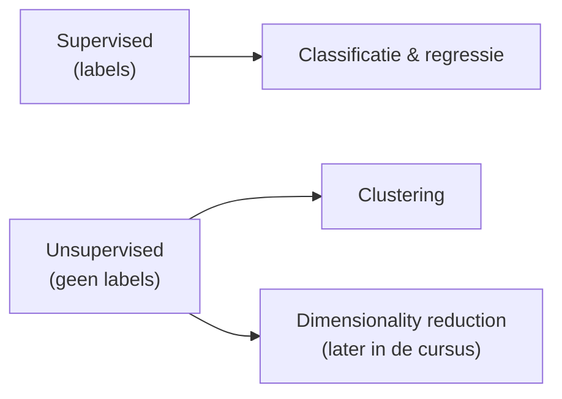
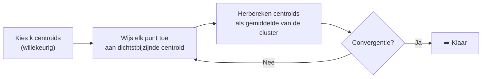

# Week 5 — Clustering: KMeans

> Notebook: `week05kmeans.ipynb`

## Herhaling: supervised vs unsupervised

- Vorige weken (KNN, SVM, beslissingsbomen & ensembles): steeds met **gelabelde data** getraind (*supervised learning*); het model leert de **verbinding** tussen features en labels.
- Vandaag voor het eerst **zonder labels**: *unsupervised learning*! Het algoritme ontdekt zelf **groepen (clusters)** in de data.



## Waarom clustering?

- **Segmentering** (bv. klantgroepen)
- **Versimpeling** van de verscheidenheid van data
- **Data reductie**
- Segmenteren van beelden (labo)
- Clustering is vaak 1 van de eerste dingen die je kunt doen wanneer je dataset **geen labels** heeft.

## KMeans

### Hoeveel clusters?

- **k moet je zelf meegeven** — het algoritme beslist dit niet zelf (visueel kan dat vaak wel, maar in het echt kan je niet altijd "kijken").

### Werking

- Grofweg uitgelegd (herhaal tot **convergentie**):
  1. Kies centroids
  2. Bepaal voor elk punt de cluster
  3. Update centroids als nieuw gemiddelde van de cluster
  4. Herhaal tot alles stabiel is (convergentie)



### KMeans in sklearn

```python
from sklearn.cluster import KMeans

k = 5
kmeans = KMeans(n_clusters=k, random_state=42, n_init=10)
y_pred = kmeans.fit_predict(X)
```

- `y_pred` = de **voorspelde cluster** per instance; de centroids staan in `kmeans.cluster_centers_`.
- Opgelet: de clusters staan verwarrend genoeg in `kmeans.labels_` — het zijn **voorspellingen**, geen echte labels.

### Voronoi decision boundaries

- De decision boundaries van KMeans zijn **Voronoi cellen**: elk punt binnen een Voronoi-cel ligt het dichtst bij de centroid van die cluster.

### Hard vs soft clustering

- **Hard clustering**: elk punt krijgt exact 1 cluster (standaard).
- Soms horen randpunten eigenlijk bij een andere cluster → info gaat verloren.
- **Soft clustering**: meet de **afstand tot elke cluster** — je behoudt meer informatie en ziet de randgevallen:

```python
X_new = np.array([[0, 2], [3, 2], [-3, 3], [-3, 2.5]])
kmeans.transform(X_new).round(2)   # afstand tot elke centroid
```

### Het probleem van initialisatie

- KMeans start met de centroids op **willekeurige** plaatsen → **niet deterministisch**; er kunnen vreemde situaties ontstaan.
- In de praktijk start KMeans typisch **10× random** (`n_init=10`) en houdt de **beste oplossing** bij; heb je een idee van de locatie van de centroids, dan kan je ze **zelf meegeven**:

```python
good_init = np.array([[-3, 3], [-3, 2], [-3, 1], [-1, 2], [0, 2]])
kmeans = KMeans(n_clusters=5, init=good_init, n_init=1, random_state=42)
kmeans.fit(X)
```

### Inertia (goedheid van de oplossing)

- Bereken voor de stabiele oplossing de **afstand tussen elk punt en zijn centroid**; kwadrateer en tel alles op → **Mean Squared Distance = inertia**:

$$\text{inertia} = \sum_{i=1}^{m} \left\| x^{(i)} - \mu_{c^{(i)}} \right\|^2$$

- Hoe lager de inertia, hoe beter. De `score()` van een sklearn-model is typisch een getal dat **zo hoog mogelijk** moet zijn — precies het tegengestelde → **score = −inertia**:

```python
kmeans.inertia_   # 211.60...
kmeans.score(X)   # -211.60...
```

### Toepassing: GSM-masten

- Telecomoperatoren plaatsen GSM-masten zodanig dat elke mast ongeveer **even zwaar belast** wordt (en (bijna) iedereen dekking heeft); de ideale locaties kan je met **KMeans** bepalen (in de praktijk ook rekening houden met hoge gebouwen).
- Zelfde idee: wandelafstand tot het dichtstbijzijnde metrostation in London.

## OPGELET: KMeans is NIET KNearestNeighbors

| KMeans | KNearestNeighbors |
|---|---|
| Clustering | Classificatie of regressie |
| k = aantal clusters | k = aantal buren; het aantal labels kan iets helemaal anders zijn |
| Inertia/scoring: MSE over héle dataset | MSE voor afstand nieuw item tot andere items |

## Mini-batch (online learning)

- Twee types van learning:
  - **Batch learning**: traint op een vaste trainingsset; updaten betekent opnieuw trainen (offline).
  - **Online learning**: leer incrementeel bij vanuit een stroom van data (aandelenprijzen, sensordata, …).
  - **Mini-batch** = online learning in kleine groepjes.
- De **learning rate** bepaalt hoe snel het model zich aanpast: hoog = snel, maar oude tendenzen vergeten; laag = omgekeerd.
- Opgelet met de naam: bij **batch learning** is 'batch' de *volledige* dataset in 1 keer; een **mini-batch** is net een *klein stukje* van de datastroom.
- Mini-batch is handig voor **heel grote datasets**, geeft iets **minder nauwkeurige** resultaten (valt in de praktijk goed mee) en is qua training **bijna altijd performanter**.

```python
from sklearn.cluster import MiniBatchKMeans

minibatch_kmeans = MiniBatchKMeans(n_clusters=5, random_state=42)
minibatch_kmeans.fit(X)
```

- Voor datasets die **niet in het geheugen passen**: **memmap** (out-of-core learning: het algoritme kapt de data in stukken die wél in memory passen):

```python
X_memmap = np.memmap('my_map.mmap', dtype='float32',
                     mode='write', shape=X_train.shape)
X_memmap[:] = X_train
X_memmap.flush()   # wijzigingen naar disk schrijven
# …
minibatch_kmeans.fit(X_memmap)
```

## Hoe bepaal je het ideale k?

- In het echt kan je niet altijd "kijken" — je kan effectief **te veel of te weinig clusters** hebben.

### Elbow method

- Voor elke nieuwe cluster daalt de totale **inertia**; zoek de **'knik'** in die curve — erna wordt het veel minder snel beter ("elbow method"):

```python
kmeans_per_k = [KMeans(n_clusters=k, random_state=42, n_init=10).fit(X)
                for k in range(1, 10)]
inertias = [model.inertia_ for model in kmeans_per_k]
```

### Silhouette score

- De silhouette score is het **gemiddelde van de silhouette coëfficiënt** over alle datapunten:

$$\frac{b-a}{\max(a,b)}$$

  met $a$ = gemiddelde afstand binnen de eigen cluster, $b$ = afstand tot de dichtstbijzijnde andere cluster.
- Typische waarden per punt:
  - **1**: datapunt centraal in eigen cluster
  - **0**: datapunt dicht bij een grens
  - **−1**: datapunt zit mogelijk niet in de juiste/logische cluster
- Hoe hoger de totale silhouette score, hoe beter.

```python
from sklearn.metrics import silhouette_score
silhouette_score(X, kmeans.labels_)
```

- Vergelijk de score in functie van k (bv. hier scoort $k=4$ het beste; ook $k=5$ is een goede keuze, en 7 beter dan 6):

```python
silhouette_scores = [silhouette_score(X, model.labels_)
                     for model in kmeans_per_k[1:]]
```

- **Silhouette diagram**: plot voor **elk punt** in de dataset de silhouette coëfficiënt — je ziet meteen of sommige clusters **meer punten** bevatten (hoogte van elke 'vin'); in het rood zie je de totale score.

## Belang van scaling

- Nog maar eens is het belangrijk dat je dataset goed is **geschaald** (zie ook KNN/SVM).
- Wanneer de clusters **niet rond** zijn, maar bijvoorbeeld rechthoekig of uitgerokken in bepaalde richtingen, werkt KMeans **niet meer goed**.

## Toepassingen van KMeans

- **Customer segmentation**: bv. Netflix, Telenet met veel info over kijkgedrag (recommender systems, later in de cursus).
- **Data analyse**: clustering is nuttig tijdens het exploratieproces.
- **Dimensionality reduction**: per datapunt enkel de afstand tot de k clustercenters bijhouden.
- **Anomalie detectie**: item ver weg van alle clustercenters = vreemd geval (later in de cursus).
- **Semi-supervised learning**: weinig labels? Verspreid ze via clustering over de hele cluster.
- **Segmentatie van beelden** (groeperen per pixel).

## Beste praktijken (Week 5)

- KMeans heeft **k als input** — het algoritme kiest dit niet zelf; de boundaries zijn **Voronoi cellen**.
- KMeans is **niet deterministisch**: sklearn probeert standaard `n_init=10` random starts en houdt de beste bij, of geef zelf `init=` mee.
- Kwaliteit meten met **inertia** (lager = beter, `score = -inertia`) en de **elbow method**.
- Gebruik de **silhouette score** (per punt en globaal) om $k$ en de kwaliteit van clusters te beoordelen.
- Grote datasets: **MiniBatchKMeans** (+ `np.memmap` voor out-of-core learning).
- **Schaal je data**: KMeans werkt slecht bij uitgerokken clusters.
- Verwar KMeans niet met KNN: het ene is clustering (unsupervised), het andere classificatie/regressie (supervised).

## Kernpunten

- Clustering = **unsupervised learning**: groeperen van gelijkaardige objecten zonder labels.
- Werking: centroids initialiseren → punten toewijzen → centroids herberekenen → herhalen tot **convergentie**.
- Hard clustering (1 cluster per punt) vs **soft clustering** (afstand tot elke cluster via `transform`).
- **KMeans ≠ KNearestNeighbors**: clustering vs classificatie/regressie, verschillende betekenis van $k$.
- k bepalen via **elbow** en **silhouette**; grote data via **mini-batch / memmap**.

