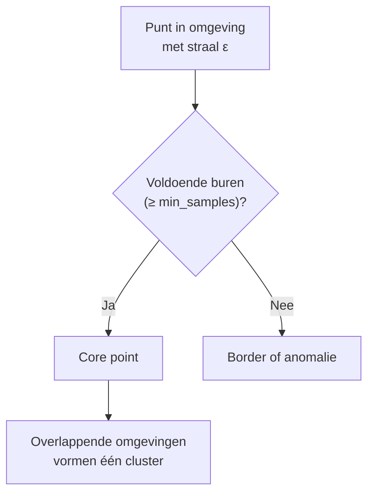
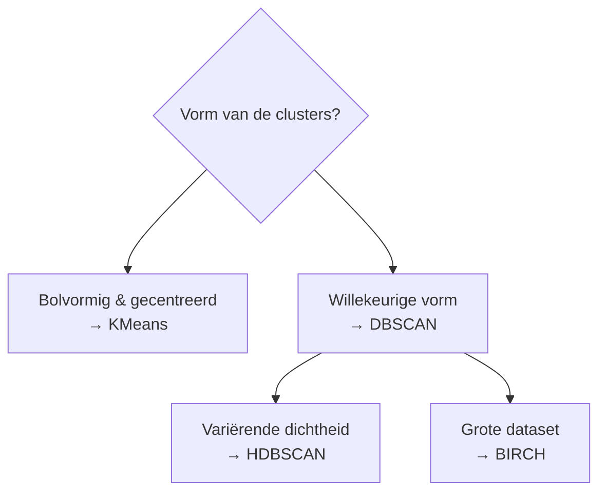

# Week 6 — Clustering met DBSCAN

> Notebook: `week06dbscan.ipynb`

## Herhaling: vorige week KMeans

- Clustering is **unsupervised learning**: het algoritme ontdekt zelf **groepen** in de data.
- KMeans verdeelt de data in **k clusters** rond centroids; het werkt goed op **bolvormige, gecentreerde** clusters.
- Vandaag: wat gebeurt er als de clusters **geen nette vorm** hebben en de data een **lokale structuur** heeft?

## Wat als KMeans onvoldoende is

- Data is niet altijd netjes gecentreerd — bv. de typische **moons-dataset** (data rond elkaar gedraaid); KMeans gaat daar **nooit echt goed** werken.
- KMeans verdeelt de ruimte steeds in **bolvormige** groepen en ziet **geen verband** tussen punten die dicht bij elkaar liggen maar tot verschillende 'armen' behoren.
- Nodig: een algoritme dat werkt op basis van **lokale dichtheid**.

## DBSCAN

- **Geen eisen** op vlak van de vorm van de data.
- DBSCAN **scant de omgeving** van een punt en **rijgt ketens van punten** aan elkaar.
- Werkt goed als er zones zijn met gelijkaardige punten dicht op elkaar (**dense zones, hotspots**).

### Werking: core points

- Het algoritme kijkt bij elk punt of er **voldoende buren** zijn; is dat zo, dan wordt het punt een **core point**; **overlappende omgevingen** vormen samen 1 grote cluster.
- Parameters:
  - `eps`: de **straal** van de omgeving
  - `min_samples`: het **minimaal aantal buren**



### Core, border en anomalie

- **Core point**: genoeg buren binnen `eps` (dense zone).
- **Border point**: aan de rand van een cluster, geen eigen dichte zone.
- **Anomalie (outlier)**: punt dat bij geen enkele cluster hoort.

### DBSCAN op de moons-dataset

- DBSCAN gebruikt **enkel de dichtheid** en geen vaste vorm → op moons krijgt hij de **twee armen** als aparte clusters.

### De `eps`-parameter

- De waarde van `eps` is belangrijk:
  - Te klein → **te veel clusters** (of alles wordt anomalie)
  - Te groot → **te weinig clusters** (alles smelt samen tot 1 groep)
- Stem `eps` en `min_samples` af op de **dichtheid** van je data.

### DBSCAN in sklearn

```python
from sklearn.cluster import DBSCAN

dbscan = DBSCAN(eps=0.05, min_samples=5)
dbscan.fit(X)
```

- DBSCAN heeft **geen `predict`-methode**, maar wel `fit_predict`.
- `fit` berekent core points, border points en de cluster-graaf.
- `fit_predict` geeft een array van labels terug, met **`-1` voor de anomalieën**.

### Items opdelen: core, anomalie en rest

```python
core_mask = np.zeros_like(dbscan.labels_, dtype=bool)
core_mask[dbscan.core_sample_indices_] = True

anomalies_mask = dbscan.labels_ == -1   # items zonder label

non_core_mask = ~(core_mask | anomalies_mask)
```

- De core points staan in `dbscan.core_sample_indices_`; de labels zitten in `dbscan.labels_` (met `-1` = anomalie).

## Overige clusteringalgoritmes

### HDBSCAN

- Een **geavanceerde versie** van DBSCAN.
- Kan om met **variërende dichtheden**, iets waar DBSCAN moeite mee heeft — versta het als clusteren met DBSCAN terwijl je **verschillende `eps`-waarden** probeert.
- De keuze van `eps` bepaalt of kleine of grote clusters ontdekt worden; bij **onbekende dichtheden** is de juiste `eps` moeilijk te kiezen — HDBSCAN lost dat automatisch op (zie de Python notebook).

### BIRCH

- **B**alanced **I**terative **R**educing and **C**lustering using **H**ierarchies.
- Werkt vooral goed op **grote datasets**, omdat het **in batches** kan werken (net als KMeans).
- Vereenvoudigt eerst de dataset tot een kleinere **summary-dataset**.
- Nadeel: kan **enkel met numerieke waarden** werken.

### Vergelijking clustering methodes



- KMeans en DBSCAN zijn de technieken voor de oefeningen.

## Clustering op images

- We gebruiken **opencv2** om met afbeeldingen te werken; via clustering kunnen we afbeeldingen verdelen in clusters door te clusteren op de **soorten kleuren** die we tegenkomen.
- Elke pixel is een punt in de kleurruimte (bv. RGB); clustering groepeert de gelijkaardige kleuren samen.

## Beste praktijken (Week 6)

- Kies **KMeans** voor bolvormige, gecentreerde clusters; kies **DBSCAN** bij willekeurige vormen of wanneer lokale structuur belangrijk is.
- Stem **`eps` en `min_samples`** af op de dichtheid van je data.
- Punten met label **`-1`** zijn geen cluster, maar **anomalieën / outliers**.
- Grote datasets → **BIRCH**; variërende dichtheden → **HDBSCAN**.

## Kernpunten

- DBSCAN is **vorm-onafhankelijk** en werkt op **lokale dichtheid** via core points.
- Parameters: `eps` (straal) en `min_samples` (aantal buren).
- Punten zonder cluster (label `-1`) vallen er meteen uit als **outliers**.
- Alternatieven: **HDBSCAN** (geavanceerder), **BIRCH** (grote datasets).

