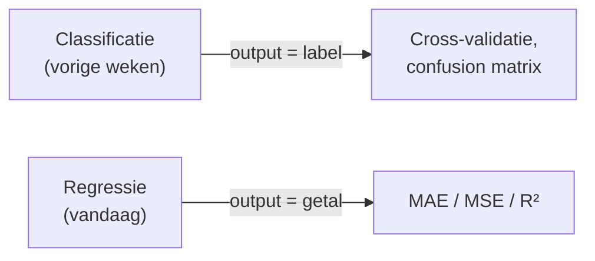
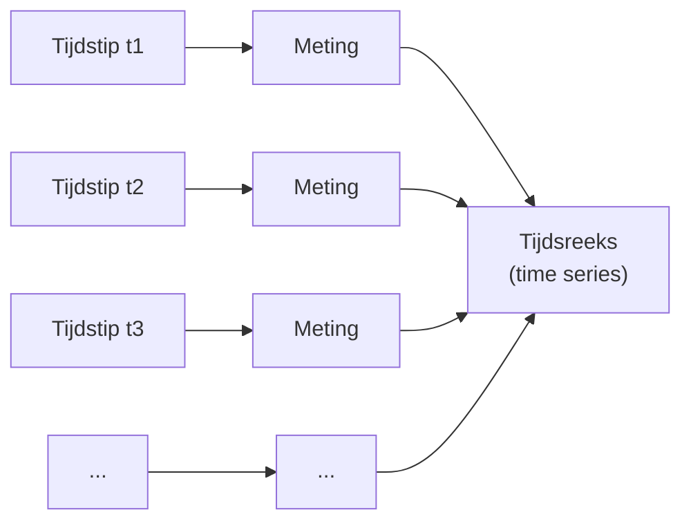
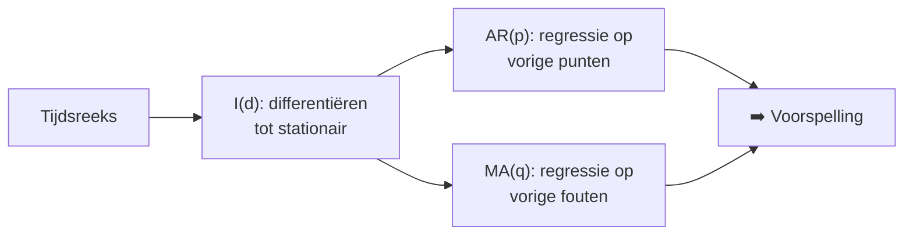
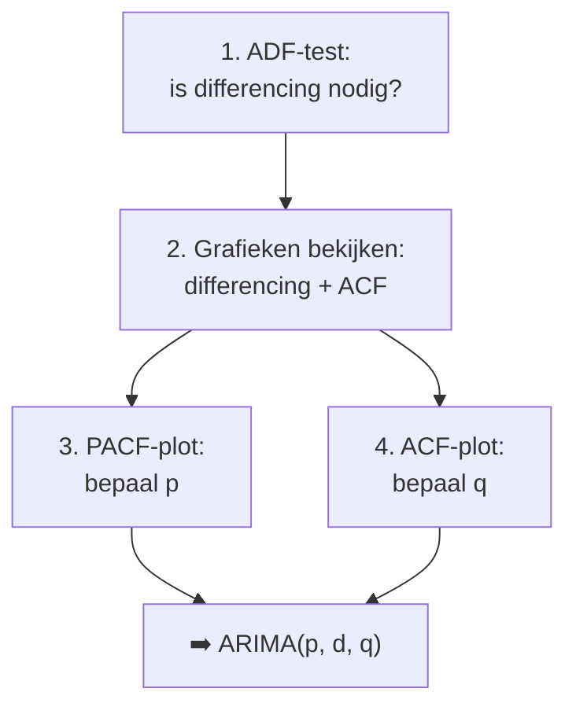

<!-- _class: title-slide -->

# Week 4
## Regressie & Forecasting: ARIMA, Kalman Filters

---

<!-- _class: red-bg -->
## Herhalen

---

## Vorige week: Random Forests & Ensembles

- **Bagging / Random Forest:** parallel trainen van bomen op random subsets → minder variantie
- **Boosting:** sequentieel, elk model corrigeert de vorige (AdaBoost, Gradient Boosting, XGBoost)
- **Stacking:** een meta-model ('blender') leert de ensembleleden combineren

> 📌 Tot nu toe waren al onze modellen **classifiers** van gelabelde, categorieke data. Vandaag: wat als de output **numeriek** is in plaats van categorisch?

---

<!-- _class: red-bg -->
## Regressie

---

## Dezelfde algoritmes als regressor

- De modellen die we al kennen hebben ook een **Regressor-variant** in sklearn

```python
from sklearn.neighbors import KNeighborsRegressor
from sklearn.svm import SVR
from sklearn.ensemble import RandomForestRegressor

knn = KNeighborsRegressor(n_neighbors=5)
svr = SVR(kernel='linear')
rf  = RandomForestRegressor(n_estimators=100, random_state=42)
# elk: .fit(X_train, y_train); predictions = model.predict(X_test)
```

> Zie notebook `week04basis_regressie.ipynb` 📓

---

## Regressie evalueren

```python
mae = mean_absolute_error(y_test, y_pred)
mse = mean_squared_error(y_test, y_pred)
r2  = r2_score(y_test, y_pred)
```

- **MAE** = gemiddelde absolute fout
- **MSE** = gemiddelde gekwadrateerde fout; de meest gekende, **zo laag mogelijk** is het best
- $R^2$ = de absolute standaard

---



> **Probeer eerst dezelfde algoritmes als *Regressor*-variant** voor je iets complexers neemt ✅

---

<!-- _class: red-bg -->
# Tijdsreeksen

---

## Tijdsreeksen



- Data uit tijdsreeksen komt heel vaak voor in (industriële) processen
  - Meetwaarden van machines, logs, opvolging van winst doorheen de tijd, …
- Voor tijdsreeksen zijn er **speciale technieken** die de tijdsdimensie een speciale status geven

---

## Forecasting

- Vaak willen we een model waarmee we **patronen kunnen vinden**
- En/of waarmee we **in de toekomst datapunten kunnen voorspellen**: forecasting


> 📌 Notebooks bij deze les: `week04basis_regressie.ipynb` en `week04arima_uitgebreide_versie.ipynb`

---

## Lineaire regressie

- Een heel simpel model om time series data te modelleren is lineaire regressie
- Zoals de naam het zegt geeft dit **enkel een lineair verband**

> [DEMO] lineaire fit op simpele data — `week04arima_uitgebreide_versie.ipynb`

---

## Lineaire regressie: beperkt

- Lineaire regressie kan in veel datasets **geen goede fit** geven
- Bijv. sinuspatronen, kwadratische trends, seizoenspatronen
- We hebben dus een **algemener regressiemodel** nodig

---

<!-- _class: red-bg -->
# ARIMA

---

## ARIMA: een algemener regressiemodel

**A**uto**R**egressive **I**ntegrated **M**oving **A**verage

| Onderdeel | Parameter | Betekenis |
|---|---|---|
| AutoRegression | $p$ | hoeveel vorige datapunten meenemen |
| Integration | $d$ | hoe vaak differentiëren tot de reeks stationair is |
| Moving Average | $q$ | hoeveel vorige errorwaardes meenemen |

$$ \mathrm{ARIMA}(p, d, q) $$

---



- Voorwaarden: geen cyclische trends, weinig outliers, variatie rond het gemiddelde blijft consistent in functie van de tijd

---

## AutoRegression: parameter p

- Voorspelling op basis van de **vorige outputs** van het model (*lags*):

$$ y_t = \beta_0 + \beta_1 y_{t-1} + \beta_2 y_{t-2} + \ldots + \beta_{p} y_{t-p} $$

| | $p$ hoog | $p$ laag |
|---|---|---|
| Geschiedenis | veel vorige datapunten meenemen | minder lange geschiedenis |
| Reactie | weinig responsief voor plotse wijzigingen | reageert sneller op plotse wijzigingen |

---

## AutoRegression

- [DEMO] Varieer de waarde van $p$ en bekijk het effect op de fit
- Zie notebook `week04arima_uitgebreide_versie.ipynb`

```python
from statsmodels.tsa.arima.model import ARIMA

model = ARIMA(df.value, order=(p, 0, 0))  # enkel AR-term
model_fit = model.fit()
```

---

## Moving Average: parameter q

- Voorspelling op basis van de **errorwaardes** (residuals) van het verleden:

$$ y_t = \Phi_0 + \Phi_1 \epsilon_{t-1} + \Phi_2 \epsilon_{t-2} + \ldots + \Phi_q \epsilon_{t-q} $$

| | $q$ hoog | $q$ laag |
|---|---|---|
| Fouten | veel vorige foutwaardes meenemen | weinig vorige foutwaardes meenemen |

> ⚠️ Laat je niet vangen door de term 'moving average': een simpel lopend gemiddelde van cijfers is **NIET** wat hier gebeurt!

---

## Integration: parameter d

- De vorige methodes werken enkel wanneer de tijdsreeks **stationair** blijft door de tijd
- Dat is in de praktijk natuurlijk **zelden** het geval
- Oplossing: kijk naar de **verschillen tussen elke tijdsstap** en maak daar een nieuwe tijdsreeks mee:

$$ \Delta y_t = y_t - y_{t-1} $$

- Dit proces herhalen we (parameter $d$) tot de nieuwe reeks **stabiel** is

> 📌 het berekenen van $\Delta$ is de numerieke versie van een afgeleide nemen. Een veelterm is na een aantal keer afleiden een constante; en uit die filosofie herhalen we dit proces op tijdsreeksen tot die stabiel (ongeveer constant) zijn.

---

## Integratieparameter d

| | kenmerken |
|---|---|
| **Hoge $d$** | reeksen met een kwadratisch verband zijn na $d=2$ constant; voor reeksen die heel abrupt gedrag vertonen (hard slingeren) |
| **Lage $d$** | lineaire reeksen zijn na $d=1$ al stationair; de reeks wordt redelijk snel stationair |

- Als een parameter op 0 wordt gezet, doet dat element **niet mee** in het model
- Bv. een zuiver 'moving average' trendlijn: $p=0$ en $d=0$

---

## Hoe parameters bepalen?

- We moeten goede waardes vinden voor $p$, $q$ en $d$



---

<!-- _class: red-bg -->
## Stap 1: Stationariteit

---

## Differencing bepalen: Adfuller-test

- Eerst met de **Adfuller-test** bepalen of je effectief differencing moet doen
- Null-hypothese van de ADF-test: de time series is **niet-stationair**

```python
from statsmodels.tsa.stattools import adfuller
from numpy import log

result = adfuller(df.value.dropna())
print('ADF statistiek: %f' % result[0])
print('p-waarde: %f' % result[1])  # als p > 0.05 -> differencing toepassen
```

- Als $p > 0.05$: de reeks is vermoedelijk **niet-stationair** → differencing toepassen

---

## Voorbeeld: random tijdsreeks

```python
np.random.seed(41)
time_series = np.cumsum(np.random.randn(100))
df = pd.DataFrame({'value': time_series})

plt.figure(figsize=(12, 6))
plt.plot(df['value'])
plt.title('Time Series Data')
plt.xlabel('Tijd')
plt.ylabel('Waarde')
plt.show()
```

> Zie notebook `week04arima_uitgebreide_versie.ipynb` 📓

---

<!-- _class: red-bg -->
## Stap 2: d bepalen via grafieken

---

## Differencing bepalen via autocorrelatieplots

- We doen wat differencing, en kijken hoe de plots en de autocorrelatie er intussen uitzien

```python
fig, axes = plt.subplots(3, 2, sharex=True)
axes[0, 0].plot(df.value); axes[0, 0].set_title('Originele data')
plot_acf(df.value, ax=axes[0, 1])

axes[1, 0].plot(df.value.diff()); axes[1, 0].set_title('1st Orde Differencing')
plot_acf(df.value.diff().dropna(), ax=axes[1, 1])

axes[2, 0].plot(df.value.diff().diff()); axes[2, 0].set_title('2nd Orde Differencing')
plot_acf(df.value.diff().diff().dropna(), ax=axes[2, 1])
plt.show()
```

> Zie notebook `week04arima_uitgebreide_versie.ipynb` 📓

---

## Interpreteer de plots

- Na 1 keer differentiëren gedraagt de data zich al als een **stationaire reeks**
- Verder differentiëren is dus **niet nodig**: de tweede orde brengt niks bij
- ➡️ **$d = 1$**

> 📌 Voorwaarden van het model: geen cyclische trends, weinig outliers, variatie rond het gemiddelde blijft consistent in functie van de tijd

---

## Conda-omgeving

Package installeren kan problemen geven — maak hiervoor **best een nieuwe conda-omgeving**:

```bash
conda config --add channels conda-forge
conda config --set channel_priority strict
conda install pmdarima
```

---

<!-- _class: red-bg -->
## Stap 3: p en q bepalen

---

## p zoeken: Partial Autocorrelation (PACF)

- PACF geeft de correlatie aan tussen een **lag** en heel de reeks
- Op basis van de PACF kan je beslissen **hoeveel lags** er nodig zijn in de AR

```python
fig, axes = plt.subplots(1, 2, sharex=True)
axes[0].plot(df.value.diff()); axes[0].set_title('1st Differencing')
axes[1].set(ylim=(0, 5))
plot_pacf(df.value.diff().dropna(), ax=axes[1])
plt.show()
```

> Zie notebook `week04arima_uitgebreide_versie.ipynb` 📓

---

## PACF: hoe lees je dit af?

- Je wil in essentie de lags bijhouden die **buiten de lichtblauwe zone** komen
- Hier komt na de **eerste** bijna niets meer erboven
- ➡️ **$p = 1$** is een goede keuze

---

## q zoeken: Autocorrelation (ACF)

- Net zoals we naar de PACF-plot kijken voor de AR-termen, kijken we naar de **ACF-plot** voor het aantal MA-termen $q$
- De ACF toont hoeveel MA-termen er nodig zijn om eventueel resterende autocorrelatie **weg te werken** zodat er een stationaire reeks overblijft

```python
fig, axes = plt.subplots(1, 2, sharex=True)
axes[0].plot(df.value.diff()); axes[0].set_title('1st Differencing')
axes[1].set(ylim=(0, 1.2))
plot_acf(df.value.diff().dropna(), ax=axes[1])
plt.show()
```

> Zie notebook `week04arima_uitgebreide_versie.ipynb` 📓

---

## ACF: hoe lees je dit af?

- Ook hier kan je dus beginnen met **$q = 1$**
- Nu kunnen we het model fitten!

---

<!-- _class: red-bg -->
## Stap 4: ARIMA-model

---

## ARIMA-model maken en fitten

```python
from statsmodels.tsa.arima.model import ARIMA

# 1,1,1 ARIMA Model
model = ARIMA(df.value, order=(1, 1, 1))
model_fit = model.fit()
print(model_fit.summary())
```

> Zie notebook `week04arima_uitgebreide_versie.ipynb` 📓

---

## AIC: Akaike Information Criterion

- De AIC is een getal dat voor een goed model **zo laag mogelijk** is
- Als je twijfelt over verschillende versies: **check de AIC** en kies het model met de laagste waarde

> Zie [Akaike Information Criterion](https://en.wikipedia.org/wiki/Akaike_information_criterion)

---

## Residual errors

- Tot slot: kijk naar de uiteindelijke fouten
- Zijn deze normaal verdeeld met een **KDE** (Kernel Density Estimation) plot?

```python
residuals = pd.DataFrame(model_fit.resid)
fig, ax = plt.subplots(1, 2)
residuals.plot(title="Residuals", ax=ax[0])
residuals.plot(kind='kde', title='Density', ax=ax[1])
plt.show()
```

> Zie notebook `week04arima_uitgebreide_versie.ipynb` 📓

---

## Voorspellingen maken

```python
forecast_steps = 25
forecast = model_fit.forecast(steps=forecast_steps)

plt.figure(figsize=(12, 6))
plt.plot(np.arange(len(df)), df['value'], label='Gegeven data')
plt.plot(np.arange(len(df), len(df) + forecast_steps), forecast, label='Forecast', color='red')
plt.title('ARIMA Forecast')
plt.xlabel('Tijd')
plt.ylabel('Waarde')
plt.legend()
plt.show()
```

> In deze forecast zitten nu gewoon nieuwe tijdstappen die de trend van de data volgen. Je kunt nu **variëren** met de parameters van `order`.

---

## Voorbeeld: shampoo dataset

- Realistische dataset: maandelijkse shampooverkoop, ingelezen met datum als **index**

```python
def parser(x):
    return datetime.strptime('201'+x, '%Y-%m')

series = pd.read_csv('shampoo.csv', header=0, parse_dates=[0],
                     index_col=0, date_parser=parser)
series.rename(columns={'Sales':'value'}, inplace=True)
series.plot(); pyplot.show()
```

> Zie notebook `week04arima_uitgebreide_versie.ipynb` 📓

---

## Shampoo dataset: ARIMA toepassen

- Door goed naar de autocorrelatiegrafiek te kijken: op een lag van **12 maanden** is er geen correlatie
- De eerste **5 lags** zijn significant (boven het stippellijntje) → AR-parameter 5

```python
model = ARIMA(series, order=(5, 1, 0))
model_fit = model.fit()
print(model_fit.summary())
```

> De density plot van de residuals lijkt een Gaussische curve, maar is niet gecentreerd rond 0 maar rond 21.93

---

## Walk-forward validatie

- We splitsen netjes in **train en test**, en doen een *walk-forward* evaluatie:

```python
X = series.values
size = int(len(X) * 0.66)
train, test = X[0:size], X[size:len(X)]
history = [x for x in train]

for t in range(len(test)):
    model = ARIMA(history, order=(1,2,2))
    model_fit = model.fit()
    yhat = model_fit.forecast()[0]
    predictions.append(yhat)
    history.append(test[t])   # echte waarde toevoegen en herhalen
```

---

## Walk-forward: evaluatie

```python
rmse = sqrt(mean_squared_error(test, predictions))
print('Test RMSE: %.3f' % rmse)

pyplot.plot(test)
pyplot.plot(predictions, color='red')
pyplot.show()
```

> Zie notebook `week04arima_uitgebreide_versie.ipynb` 📓

---

## Finetuning: Box-Jenkins methode

1. Gebruik **plots** om trends, seasonality en autoregressie-elementen terug te vinden: bepaal zo de lag en de mate van differencing
2. Fit je model met deze **zinvolle parameters**
3. Check: zit er op de plots van de residual error nog **structuur**? Dan herhaal je het proces

---

## Finetuning: grid search

- Je kan ook een **grid search** gebruiken om de optimale parameters te vinden

```python
p_values = [0, 1, 2, 4, 6, 8, 10]
d_values = range(0, 3)
q_values = range(0, 3)
warnings.filterwarnings("ignore")
evaluate_models(series.values, p_values, d_values, q_values)
```

- Voor elke combinatie van $(p, d, q)$: fit het model, voorspel via walk-forward en bereken de RMSE
- Kies uiteindelijk de combinatie met de **laagste RMSE**

---

## Als er seizoenspatronen zijn

- De data is dan niet helemaal stationair constant
- De basisvoorwaarde van ARIMA is niet vervuld, maar er is een ander model dat een oplossing biedt: **Seasonal ARIMA**, kortweg SARIMA
- `statsmodels.tsa.statespace.sarimax.SARIMAX`
- Hier gaan we verder niet op in, maar kan handig zijn voor **projecten later**

---


<!-- _class: red-bg -->
## Samenvatten

---

## Kernpunten

- Klassieke classifiers hebben ook een **regressor-variant**; evaluatie via MAE/MSE/R²
- ARIMA = AR($p$) + I($d$) + MA($q$); parameters via **ADF-test**, **PACF** en **ACF**
- Walk-forward validatie + RMSE voor het correct evalueren van forecasting-modellen
- **SARIMA** voor seizoensdata
- **Kalman filter** voor ruisende metingen (predict + update)

---

## Notebooks bij deze les

| Notebook | Inhoud |
|---|---|
| `week04basis_regressie.ipynb` | KNN / SVR / RandomForest als regressor, MAE/MSE/R² |
| `week04arima_uitgebreide_versie.ipynb` | Lineaire regressie, volledig ARIMA-protocol, shampoo dataset, grid search |

---

# Vragen?
