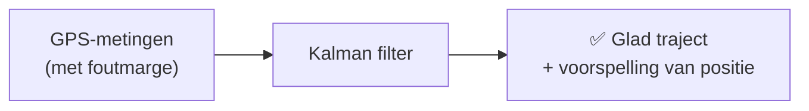
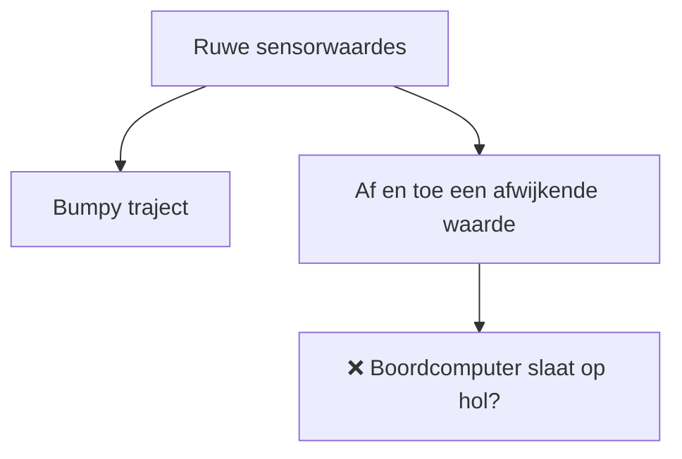
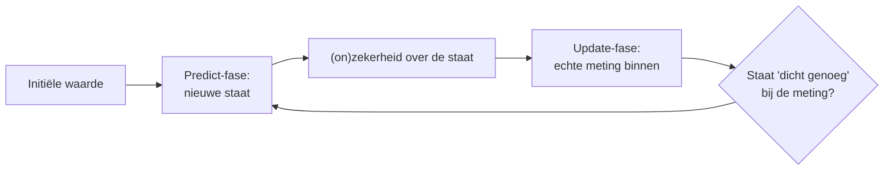

<!-- _class: red-bg -->
## Herhaling ARIMA

---

<!-- _class: red-bg -->
# Kalman Filters

---

## Tweede techniek voor tijdsreeksen: Kalman filter

- Als voorbeeldprobleem bekijken we een app, die de **GPS-locatie van een vliegtuig** aangeeft
- We proberen te **voorspellen** waar het vliegtuig naartoe gaat

---

## Het probleem met sensors

- Sensors, zoals GPS, bevatten een **foutmarge**
- Door die foutmarge kan het ruwe traject van de data er nogal 'bumpy' uitzien

---

## Kalman filter: predict en update

- De Kalman filter begint met een **initiële waarde**

---

## Kalman filter: waarom nuttig?

- In de predict-fase: geeft een **nieuwe staat** en een **(on)zekerheid** over die staat
- In de update-fase (een echte meting): kijkt of de staat **'dicht genoeg'** is bij de meting
- Dit wordt in real life ook echt gebruikt in **boordnavigatie van vliegtuigen**
- De filter vermijdt het op hol slaan van een boordcomputer als 1 sensor een keer een **afwijkende waarde** meet

> 📌 Zie ook de oefening: `kalman_oefening_oplossing.ipynb`

---

<!-- _class: red-bg -->
## Samenvatten

---

## Kernpunten

- **Kalman filter** voor noisy metingen (predict + update)

---

# Vragen?
