<!-- _class: title-slide -->

# Week 5
## Clustering met K-Means

---

<!-- _class: red-bg -->
## Herhalen

---

## Vorige weken: classificatie

- **KNN, SVM, beslissingsbomen & ensembles:** steeds met **gelabelde data** getraind (*supervised learning*)
- Het model leert de **verbinding** tussen features en labels

> 📌 Vandaag werken we voor het eerst **zonder labels**: *unsupervised learning*! We laten het algoritme zelf **groepen (clusters)** in de data ontdekken.

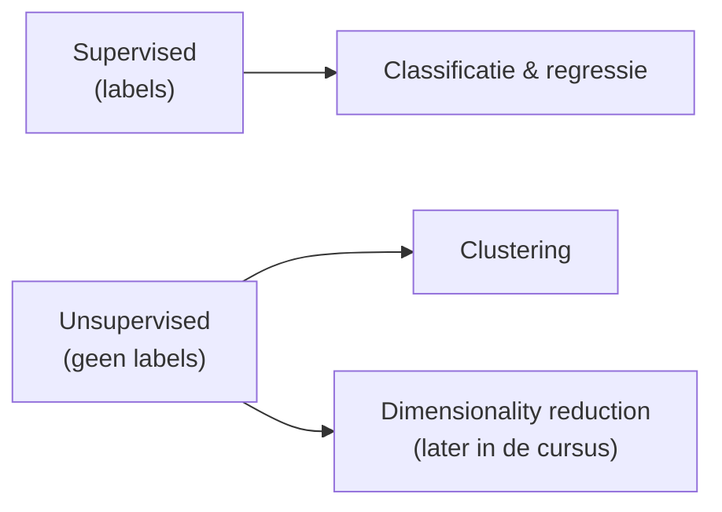

---

## Verband giraf - les

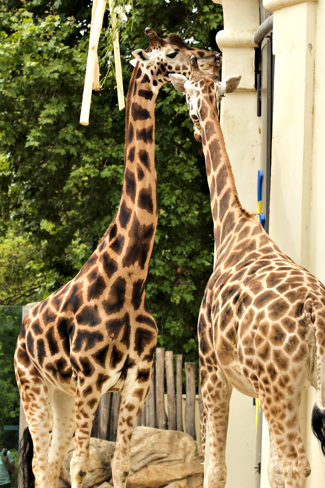

In deze les zit een ‘giraf’ verstopt…

---

<!-- _class: red-bg -->
# Waarom clustering?

---

## Waarom clustering?

- **Segmentering** (bv. klantgroepen)
- **Versimpeling** van de verscheidenheid van data
- **Data reductie**
- Segmenteren van beelden (doen we in labo)

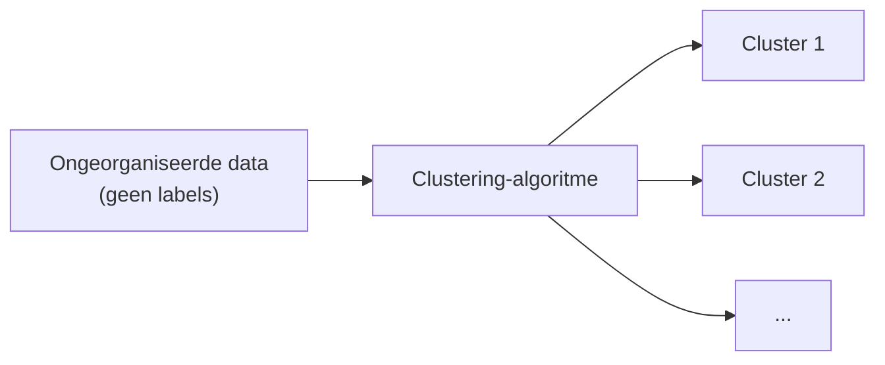

> Clustering is vaak 1 van de eerste dingen die je kunt doen wanneer je dataset **geen labels** heeft

---

<!-- _class: red-bg -->
# KMeans

---

## KMeans: hoeveel clusters?

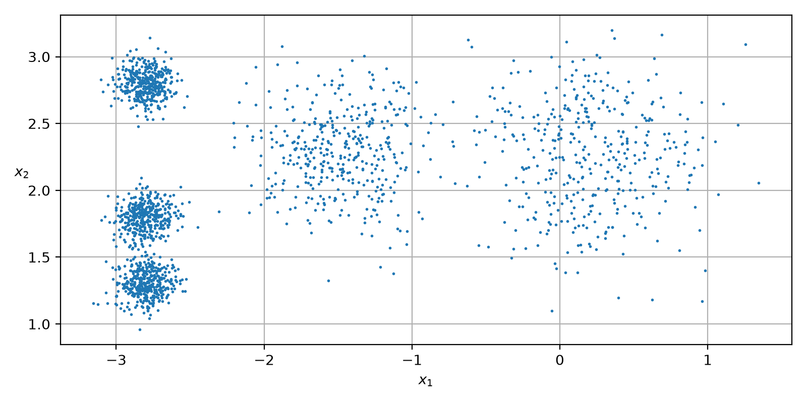

- Hoeveel clusters zou je hier verwachten?
- Dit aantal moet je **meegeven** aan het algoritme, het beslist dit niet zelf

---

## Werking KMeans

- Grofweg uitgelegd:
  - Kies centroids
  - Bepaal voor elk punt de cluster
  - Update centroids als nieuw gemiddelde cluster
  - Herhaal tot alles stabiel is (convergentie)
- [https://youtu.be/5I3Ei69I40s](https://youtu.be/5I3Ei69I40s)

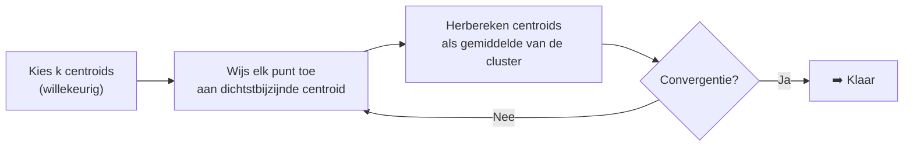

---

## KMeans in sklearn

```python
from sklearn.cluster import KMeans

k = 5
kmeans = KMeans(n_clusters=k, random_state=42, n_init=10)
y_pred = kmeans.fit_predict(X)
```

- `y_pred`: de **voorspelde cluster** per instance
- De centroids staan in `kmeans.cluster_centers_`
- Opgelet: de clusters zitten verwarrend genoeg in `kmeans.labels_`, het zijn **voorspellingen**, geen echte labels

---

## Voronoi decision boundaries

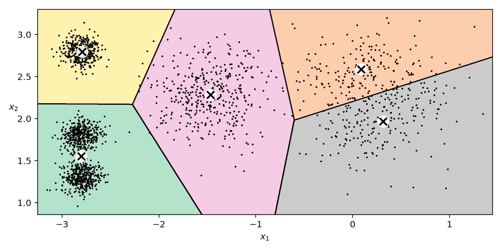

- 5 is hier een aangewezen aantal, puur visueel
- De decision boundaries van KMeans zijn **Voronoi cellen**
- Elk punt binnen een Voronoi-cel ligt het dichtst bij de centroid van die cluster

---

## Hard vs soft clustering

- **Hard clustering:** elk punt krijgt exact 1 cluster (wat we tot nu toe deden)
- Soms horen randpunten eigenlijk bij een andere cluster → info gaat verloren
- **Soft clustering:** meet de **afstand tot elke cluster**, je behoudt meer informatie (en ziet de randgevallen)

```python
X_new = np.array([[0, 2], [3, 2], [-3, 3], [-3, 2.5]])
kmeans.transform(X_new).round(2)   # afstand tot elke centroid
```

---

<!-- _class: red-bg -->
## Het probleem van initialisatie

---

## Kmeans en het probleem van initialisatie

- Kmeans start met de locatie van de centroids op **willekeurige** plaatsen
- Het algoritme is dus **niet deterministisch**
- Er kunnen dus vreemde situaties ontstaan

---

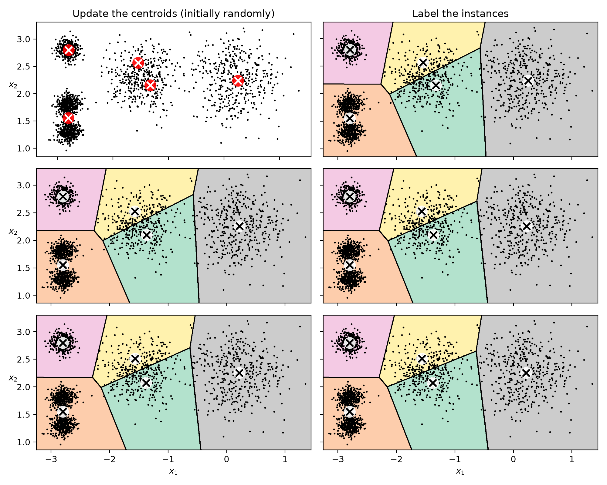

---

## Wat doet sklearn eraan?

- In de praktijk start Kmeans typisch **10 keer random** en houdt de **beste oplossing** bij
- Heb je een idee van de locatie van de centroids, dan kan je die ook **zelf meegeven**

```python
good_init = np.array([[-3, 3], [-3, 2], [-3, 1], [-1, 2], [0, 2]])
kmeans = KMeans(n_clusters=5, init=good_init, n_init=1, random_state=42)
kmeans.fit(X)
```

---

## Hoe vind je de beste oplossing? Inertia

- Bereken voor de stabiele oplossing de **afstand tussen elk punt en zijn centroid**
- Kwadrateer, tel alles op → **Mean Squared Distance**
- Dit noemen we voor Kmeans de **inertia**: hoe lager, hoe beter

$$ \text{inertia} = \sum_{i=1}^{m} \left\| x^{(i)} - \mu_{c^{(i)}} \right\|^2 $$

- De score van een sklearn-model is typisch een getal dat **zo hoog mogelijk** moet zijn, dat is precies het tegengestelde van inertia
- Dus **score = -inertia**

```python
kmeans.inertia_   # 211.60...
kmeans.score(X)   # -211.60...
```

---

<!-- _class: red-bg -->
## Mini-batch

---

## Types van Learning

- **Batch learning:** traint op een vaste trainingsset, updaten betekent opnieuw trainen (offline)
- **Online learning:** leer incrementeel bij vanuit een stroom van data (aandelenprijzen, sensordata, …)

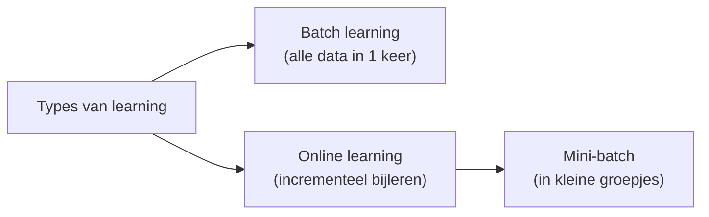

- De **learning rate** bepaalt hoe snel het model zich aanpast: hoog = snel maar oude tendenzen vergeten, laag = omgekeerd
- Opgelet met de naam 'batch': bij **batch learning** is 'batch' de *volledige* dataset in 1 keer, een **mini-batch** is net een *klein stukje* van de datastroom

---

## Mini-batch

- Online learning
- Data wordt in **stukjes** getrained
- Handig voor **heel grote datasets**
- Over het algemeen iets **minder nauwkeurig** dan alles in 1 keer trainen, maar dit valt in de praktijk heel goed mee
- Van veel algoritmes bestaat een batch-versie. Die is qua training **bijna altijd performanter** dan de originele versie

---

## Mini-batch in sklearn

```python
from sklearn.cluster import MiniBatchKMeans

minibatch_kmeans = MiniBatchKMeans(n_clusters=5, random_state=42)
minibatch_kmeans.fit(X)
```

[DEMO] Vergelijk de trainingstijd met gewone KMeans (zie cursus notebook)

---

## Datasets die niet in het geheugen passen: memmap

- Voor datasets die niet in het geheugen passen: **memmap**!

```python
X_memmap = np.memmap('my_map.mmap', dtype='float32',
                     mode='write', shape=X_train.shape)
X_memmap[:] = X_train
X_memmap.flush()   # wijzigingen naar disk schrijven
# …
minibatch_kmeans.fit(X_memmap)
```

> Out-of-core learning: het algoritme kapt de data in stukken die wél in memory passen

---

<!-- _class: red-bg -->
## Hoe bepaal ik de ideale 'k'?

---

## Hoe bepaal je hoeveel clusters je wil?

- In het echt kan je niet altijd ‘kijken’
- Je kan dus effectief **teveel of te weinig clusters** hebben

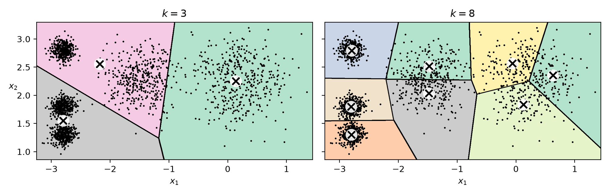

---

## Elbow method

- Voor elke nieuwe cluster zal de totale inertia **dalen**
- We kunnen zoeken naar een **‘knik’** in deze curve
- Erna wordt het veel minder snel beter

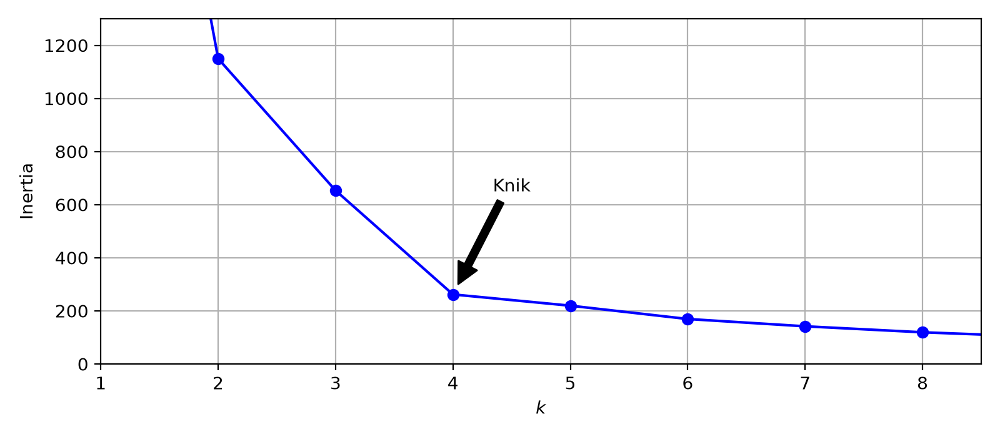

> In de grafiek is er hier een duidelijke knik bij k=4. In het Engels: ‘elbow method’

---

## Silhouette score

- De silhouette score is het **gemiddelde van de silhouette coëfficiënt** over alle datapunten
- Coëfficiënt per punt: $\frac{b-a}{max(a,b)}$, met $a$ = gemiddelde afstand binnen eigen cluster, $b$ = afstand tot de dichtstbijzijnde andere cluster
- Typische waardes:
  - **1:** datapunt centraal in eigen cluster
  - **0:** datapunt dicht bij een grens
  - **-1:** datapunt zit mogelijk niet in ‘juiste/logische’ cluster

---

## Silhouette score in sklearn

- Hoe hoger de totale silhouette score, hoe beter

```python
from sklearn.metrics import silhouette_score
silhouette_score(X, kmeans.labels_)
```

---

## Silhouette score in functie van k

- Vergelijk de silhouette score voor verschillende waardes van $k$
- Hier scoort $k=4$ het beste, en ook $k=5$ is een goede keuze (7 beter dan 6)

```python
silhouette_scores = [silhouette_score(X, model.labels_)
                     for model in kmeans_per_k[1:]]
```

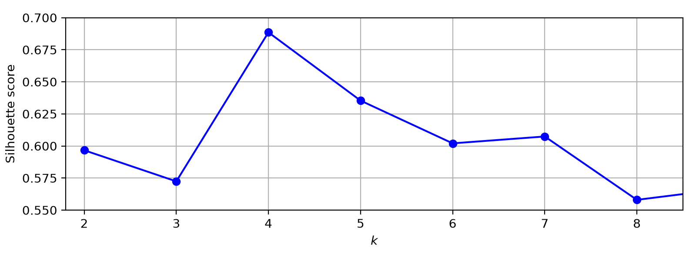

---

## Silhouette diagram

- Je kunt tot slot in plaats van enkel de totale silhouette score te plotten, voor **elk punt in de dataset** de silhouette coëfficiënt laten zien in een prentje
- Je ziet meteen ook of sommige clusters **meer punten** bevatten (hoogte van elke ‘vin’)
- In het rood zie je de totale silhouette score

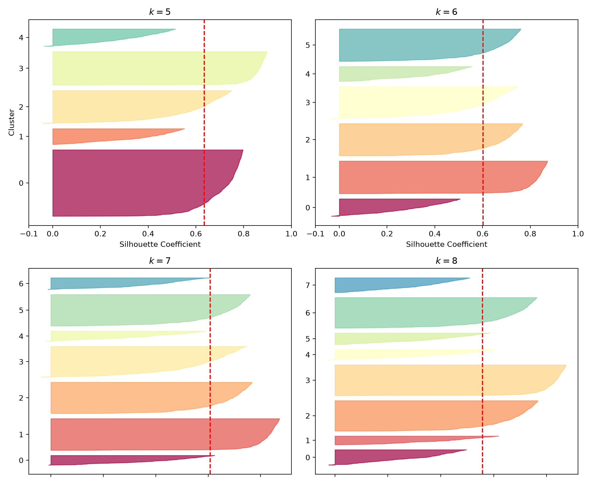

---

## OPGELET! KMeans IS NIET KNearestNeighbors

| KMeans | KNearestNeighbors |
|---|---|
| Clustering | Classificatie of regressie |
| K duidt op het aantal clusters | K duidt op het aantal buren om naar te kijken, het aantal labels kan iets helemaal anders zijn |
| Bij inertia/scoring wordt MSE berekend over hele dataset | Bij zoeken naar buren wordt MSE berekend voor afstand nieuw item tot andere items |

---

## Belang van scaling

- Nog maar eens is het belangrijk dat je dataset goed is **geschaald**
- Wanneer de clusters niet rond zijn, maar bijvoorbeeld rechthoekig of uitgerokken in bepaalde richtingen, werkt K-means **niet meer goed**

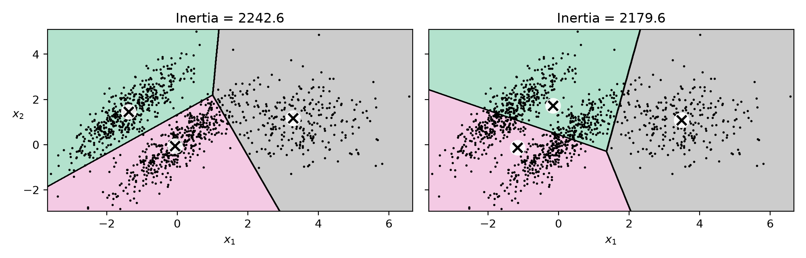

---

## KMeans en gsm masten

- Telecomoperatoren proberen GSM masten zodanig te plaatsen dat elke mast ongeveer **even zwaar wordt belast** (en (bijna) iedereen dekking heeft)
- De ideale locaties van die masten kan worden bepaald met **Kmeans**
- In de praktijk moet je ook rekening houden met hoge gebouwen, waar je die dingen idealiter wil ophangen

---

- In afbeelding hiernaast zie je hetzelfde idee, maar dan met **wandelafstand tot dichtstbijzijnde metrostation** in London

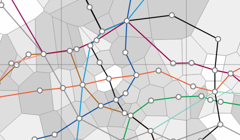

---

## Toepassingen van K-Means

- **Customer segmentation:** bv. Netflix, Telenet met veel info over kijkgedrag (recommender systems, later in de cursus)
- **Data analyse:** clustering is nuttig tijdens het exploratieproces
- **Dimensionality reduction:** per datapunt enkel de afstand tot de k clustercenters bijhouden
- **Anomalie detectie:** item ver weg van alle clustercenters = vreemd geval (later in de cursus)
- **Semi-supervised learning:** weinig labels? Verspreid ze via clustering over de hele cluster
- **Segmentatie van beelden** (groeperen per pixel)

---

<!-- _class: red-bg -->
## Samenvatten

---

## Best practices (Week 5)

- KMeans heeft **k als input** het algoritme kiest dit niet zelf; de boundaries zijn **Voronoi cellen**
- Kmeans is **niet deterministisch**: sklearn probeert standaard `n_init=10` random starts en houdt de beste bij, of geef zelf `init=` mee
- Kwaliteit meten met **inertia** (lager = beter, `score = -inertia`) en de **elbow method**
- Gebruik de **silhouette score** (per punt en globaal) om $k$ en de kwaliteit van clusters te beoordelen
- Grote datasets: **MiniBatchKMeans** (+ `np.memmap` voor out-of-core learning)
- **Schaal je data**: K-means werkt slecht bij uitgerokken clusters

---

## Kernpunten

- Clustering = **unsupervised learning**: groeperen van gelijkaardige objecten zonder labels
- Werking: centroids initialiseren → punten toewijzen → centroids herberekenen → herhalen tot **convergentie**
- Hard clustering (1 cluster per punt) vs **soft clustering** (afstand tot elke cluster via `transform`)
- **KMeans ≠ KNearestNeighbors**: clustering vs classificatie/regressie, verschillende betekenis van $k$

---

## Vragen?

- [https://app.wooclap.com/events/ZXTOQF](https://app.wooclap.com/events/ZXTOQF)

