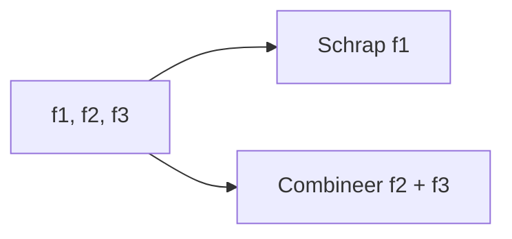
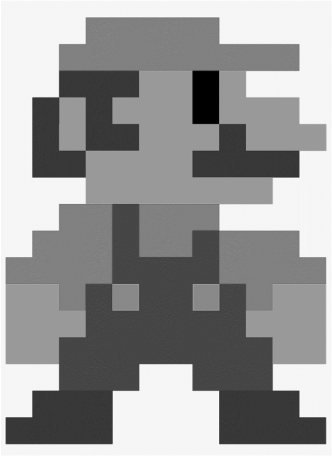
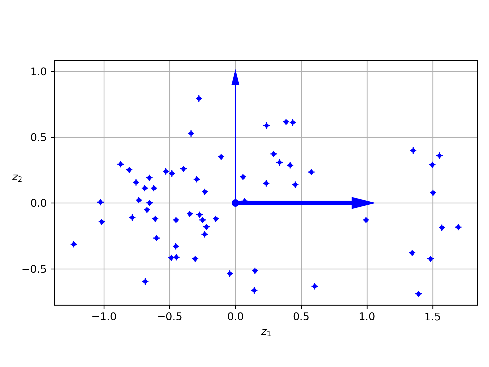
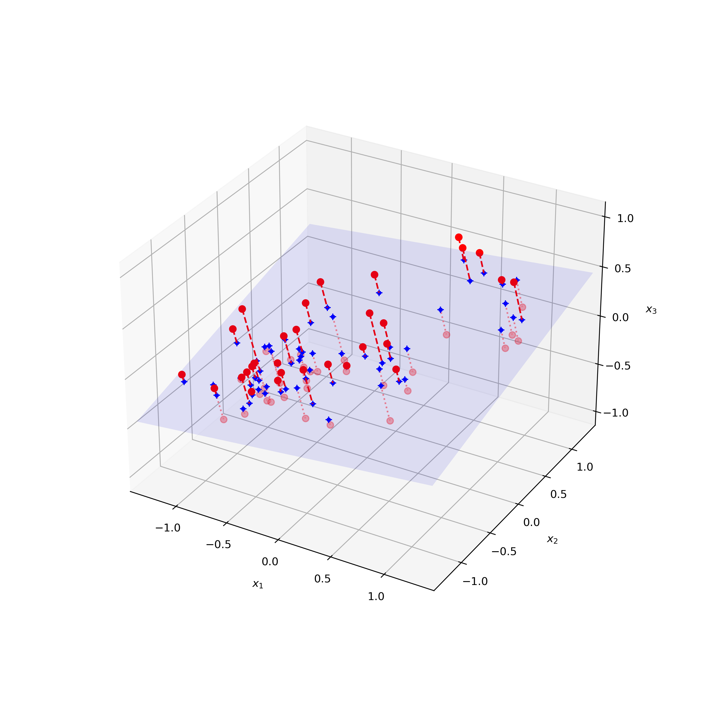
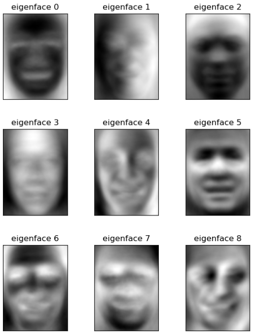
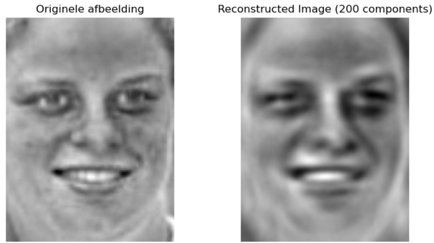
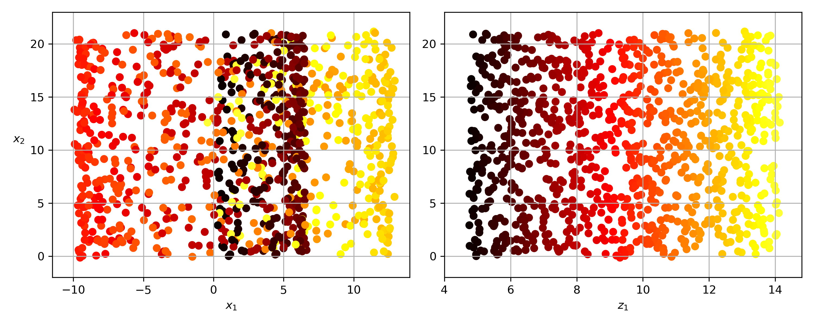
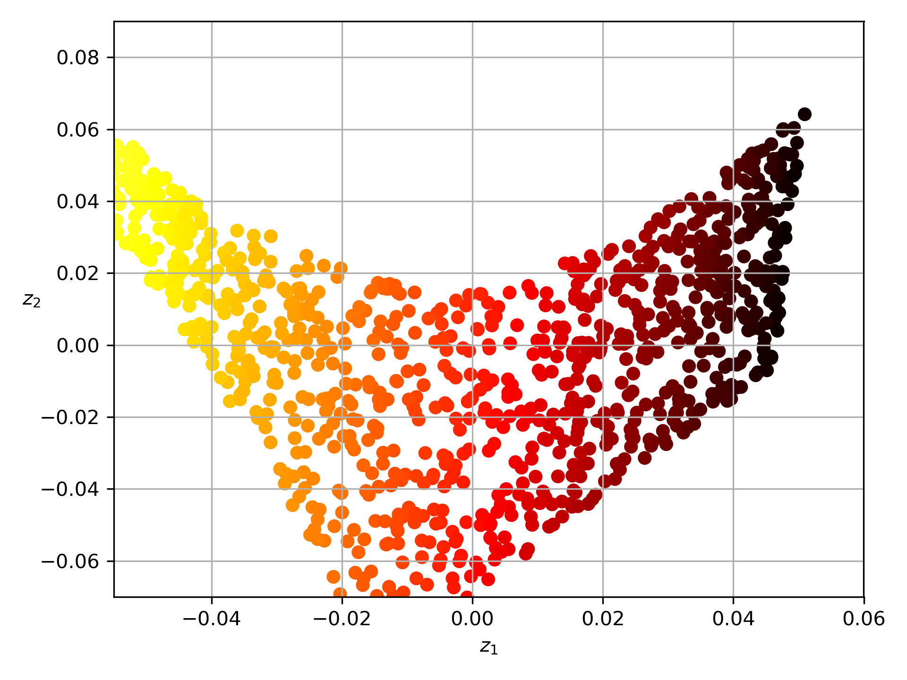
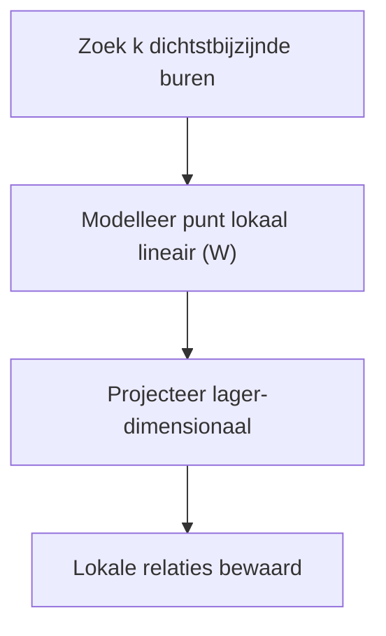

<!-- _class: title-slide -->

# Week 7
## Dimensiereductie

---

<!-- _class: red-bg -->
# Ethische opmerking

---

## Ethische opmerking

- De technieken in deze les zijn **vaak gebruikt en wettelijk OK**, maar kunnen **onethisch** worden gebruikt
- Bv. voor **bevolkingscontrole** in bepaalde landen
- Gebruik **nooit facial recognition** op data van familie, vrienden, … zonder hun **expliciete toestemming**
- Over het oneigenlijke gebruik van fotomateriaal bestaat **wetgeving**: dat mag in België **niet zomaar**

---

<!-- _class: red-bg -->
# Features zijn dimensies

---

## Features zijn dimensies

- Elk **feature** is een **dimensie** van de dataruimte
- Te veel dimensies brengt problemen mee:
  - mensen zijn **niet getraind** in het interpreteren van meer dan 3 dimensies
  - bij heel veel dimensies zijn er **heel veel mogelijkheden** voor de datapunten
- **Groot risico op overfitting**: in een hoog-dimensionale ruimte is er heel veel 'plaats'

> 💡 The curse of dimensionality: te veel features → **overfit-risico**

---

## De oplossing: dimensies verlagen

- Doel: zoveel mogelijk **variatie** (= 'informatie') van de dataset bijhouden
- Bv. **f1 schrappen** in plaats van f2 of f3
- Of maak een **nieuwe combinatie** van f2 en f3 als nieuwe kolom en houd enkel die bij



---

<!-- _class: red-bg -->
# Afbeeldingen: flattening

---

## Zwart-witfoto's zijn matrices

- ZW-foto's zijn **matrices**: m rijen × n kolommen, elke pixel is een **waarde 0–256**
- Een foto moet eerst omgezet worden naar een **datapunt (vector)**



---

## Foto naar vector: reshape

- **Flattening**: alle kolommen na elkaar → **1 lange rij**
- De data blijft identiek, de pixels **verschuiven** alleen
- Bv. **125 × 94 pixels** → een rij van **11750** waarden (dimensies)

```python
.reshape(-1)
```

---

## Een dataset van foto's

- Een dataset = **alle foto's als rijen** onder elkaar
- Elke kolom = **één pixel** op dezelfde locatie in alle foto's
- **PCA flattent de data automatisch**, dat moet je niet zelf doen

```python
from sklearn.datasets import fetch_lfw_people
people = fetch_lfw_people(min_faces_per_person=5, resize=1)
X = people.data
n_features = X.shape[1]
y = people.target
```

[DEMO] Notebook: `dimensionality_reduction.ipynb`

---

<!-- _class: red-bg -->
# PCA (Principal Component Analysis)

---

## PCA zoekt dominante richtingen

- **PCA** zoekt de **meest dominante richtingen** in een dataset
- Geeft ze terug als **principal components**: hoe minder je er vraagt, hoe **sterker** de datareductie
- Alle datapunten zijn een **lineaire combinatie** van die componenten



---

## PCA projecteert op een vlak

- Achterliggend (bv. 3 dimensies): de data ligt **in de buurt van een vlak**
- PCA berekent automatisch:
  - het **beste vlak** om op te projecteren
  - de **projecties** van alle datapunten
  - binnen het vlak, de **dominante richtingen** = de **eigenvectoren**



---

## Eigenfaces

- Bij gezichten zijn de eigenvectoren ('eigenfaces') **generieke gezichten**
- Elk gezicht is een **lineaire combinatie** van deze eigenfaces



---

## Voorbeeld: Kim Clijsters

$$ \mathrm{Kim\ Clijsters} = \sum_{i=1}^{200} c_i \cdot \mathrm{eigenface}_i $$



---

## PCA behoudt variantie

- PCA behoudt zoveel mogelijk de **variantie** van de dataset
- De componenten staan in **volgorde van belangrijkheid** (de eerste is de belangrijkste)
- De reductie = de **laatste componenten 'laten vallen'**, omdat ze **weinig waarde** bijbrengen

---

## PCA in sklearn

```python
pca = PCA(n_components=n_components, svd_solver='randomized', whiten=True).fit(X_train_scaled)
X_train_pca = pca.transform(X_train_scaled)
X_test_pca  = pca.transform(X_test_scaled)
eigenvectors = pca.components_.reshape((n_components, h, w))
```

- **Schaal je data vóór PCA** (`X_train_scaled`)

[DEMO] Notebook: `dimensionality_reduction.ipynb`

---

## PCA: variatie zelf laten kiezen

- Of laat PCA zelf het aantal kiezen voor **95% van de variatie**

```python
pca = PCA(n_components=0.95, svd_solver='randomized', whiten=True).fit(X_train_scaled)
```

- Gebruik `n_components=0.95` om automatisch **95% variatie** te behouden

---

<!-- _class: red-bg -->
# Nadelen en varianten

---

## Nadelen en varianten van PCA

- **Nadeel**: heel de dataset moet **in memory** → oplossing: **`IncrementalPCA`**
- **Nadeel**: PCA werkt met **lineaire projecties** → voor complexere data: **`KernelPCA`** met kernels (zoals bij SVM)

> 💡 PCA blijft lineair en in-memory; **IncrementalPCA** en **KernelPCA** lossen die beperkingen op

---

<!-- _class: red-bg -->
# LLE (Locally Linear Embedding)

---

## LLE voor niet-lineaire datasets

- Voor **niet-lineaire datasets** is PCA minder geschikt
- Bv. de **'swiss roll'**: een opgerold blad dat **lokaal** op een 2D-vlak lijkt


---

## Waarom PCA de structuur verliest

- Door PCA zou die structuur verloren gaan: data van **verschillende plaatsen** landt **op dezelfde regio**



---

## LLE in sklearn

```python
from sklearn.manifold import LocallyLinearEmbedding
lle = LocallyLinearEmbedding(n_components=2, n_neighbors=10, random_state=42)
X_unrolled = lle.fit_transform(X_swiss)
```



[DEMO] Notebook: `dimensionality_reduction.ipynb`

---

## Werking van LLE (distance-preserving)

- Vooral geschikt voor **'opgerolde' datasets** (swiss roll)
- Punten die **dicht bij mekaar** lagen, blijven dicht bij mekaar (**distance-preserving op lokale schaal**)
- Op **grotere afstand** blijven afstanden echter **niet** bewaard



> Werking: **niet te kennen** voor het examen

---

<!-- _class: red-bg -->
## Samenvatten

---

## Best practices (Week 7)

- Reduceer dimensies bij **veel features**: verlaagt het **overfit-risico** en bewaart zoveel mogelijk **variantie**
- **Schaal je data vóór PCA** (`X_train_scaled`); gebruik `n_components=0.95` voor **95% variatie**
- Dataset past niet in memory? Gebruik **`IncrementalPCA`**
- Niet-lineaire structuren (swiss roll): gebruik **LLE of KernelPCA**, niet gewone PCA
- Respecteer **privacy**: geen facial recognition zonder **expliciete toestemming**

---

## Kernpunten

- **Curse of dimensionality**: te veel features → **overfit-risico**
- **Flattening** zet afbeeldingen om naar vectoren; PCA zoekt **dominante richtingen** (eigenfaces bij gezichten)
- PCA = **lineair** + **in memory**
- **IncrementalPCA / KernelPCA / LLE** lossen de beperkingen van PCA op

---

## Vragen?

- [https://app.wooclap.com/events/ZXTOQF](https://app.wooclap.com/events/ZXTOQF)
